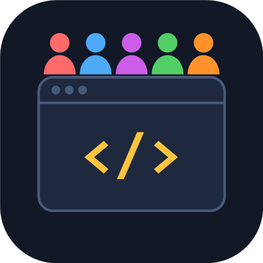
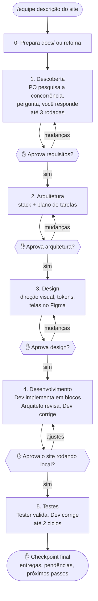

<p align="center">
  
</p>

<h1 align="center">equipe-dev</h1>

<p align="center">
  Uma equipe de agentes do <a href="https://claude.com/claude-code">Claude Code</a> que cria sites do zero:<br>
  da conversa inicial ao site testado, com você aprovando cada etapa.
</p>

<p align="center">
  
  
  
  
</p>

---

## O que é

O **equipe-dev** é um plugin do Claude Code que simula uma pequena equipe de desenvolvimento web. Em vez de pedir "faz um site" e receber um resultado genérico, você passa por um processo de verdade:

1. um **Product Owner** faz perguntas para entender o seu negócio;
2. um **Arquiteto** escolhe a tecnologia mais simples que resolve o problema;
3. um **Designer** cria uma identidade visual com personalidade;
4. um **Desenvolvedor** implementa tarefa por tarefa, e o Arquiteto revisa o código;
5. um **Tester** confere cada requisito e reporta os bugs, que voltam para correção.

Você só precisa digitar um comando e responder às perguntas. Em cada etapa a equipe para, mostra um resumo e **só segue com a sua aprovação**.

```
/equipe quero um site para minha barbearia
```

## A equipe

| | Agente | Papel | Entrega |
|---|---|---|---|
| 🧭 | **`po`** — Product Owner | Pesquisa a concorrência na web (o que outros sites do segmento oferecem e com que tecnologia), faz perguntas objetivas em rodadas curtas e transforma as respostas em requisitos com histórias de usuário e critérios de aceite | `docs/00-concorrencia.md`<br>`docs/01-requisitos.md` |
| 🏗️ | **`arquiteto`** — Arquiteto / Tech Lead | Escolhe a stack (HTML/CSS/JS, Astro, Next.js...), define pastas, convenções, deploy e um plano de tarefas pequenas. Depois faz o code review | `docs/02-arquitetura.md`<br>`docs/05-code-review.md` |
| 🎨 | **`ui-ux`** — Designer | Cria a direção visual (com referências do [Taste Skill](https://www.tasteskill.dev/), [Transitions.dev](http://transitions.dev/) e [React Bits](https://reactbits.dev/)), mapa do site, wireframes, design tokens, componentes, animações e checklist WCAG AA. Desenha as telas no **Figma** | `docs/03-design.md`<br>telas no Figma |
| 💻 | **`desenvolvedor`** — Desenvolvedor | Implementa uma tarefa por vez, consultando as telas do Figma, sem mudar escopo nem stack por conta própria, e corrige o que vier do review e dos testes | código do site<br>`docs/progresso.md` |
| 🧪 | **`tester`** — Tester / QA | Valida cada critério de aceite, links, formulários, responsividade, acessibilidade, SEO e build. Escreve testes automatizados quando possível | `docs/04-relatorio-testes.md` |

O comando **`/equipe`** é o orquestrador. Ele roda na sua sessão principal (subagentes não chamam outros subagentes), chama cada agente na hora certa, repassa as perguntas para você e controla os checkpoints.

## Como funciona



- **Nada avança sem a sua aprovação.** Se pedir mudanças, o agente responsável ajusta e o checkpoint se repete.
- **Resumos curtos.** Em cada checkpoint você vê os pontos principais e o caminho do arquivo para ler completo.
- **Pode parar e voltar depois.** Rode `/equipe` de novo na mesma pasta e o orquestrador retoma de onde parou, lendo `docs/progresso.md`.
- **Tudo em português.**

## Instalação

Pré-requisito: [Claude Code](https://claude.com/claude-code) instalado.

Recomendado: o **Figma MCP** conectado, para o UI/UX desenhar as telas e o Desenvolvedor consultá-las. Use o conector do Figma no claude.ai ou adicione pelo terminal:

```
claude mcp add --transport http --scope user figma https://mcp.figma.com/mcp
```

Depois rode `/mcp` para entrar com a conta do Figma. Para criar e editar telas pelo MCP, a conta pode precisar de um lugar com permissão de edição (Full/Dev), não só "View". Sem o Figma, a equipe funciona normalmente e o design fica só no documento.

### Modelos usados

| Agente | Modelo |
|---|---|
| `po`, `arquiteto`, `ui-ux`, `tester` | Claude Sonnet 5.5 (`claude-sonnet-5-5`) |
| `desenvolvedor` | Claude Opus 5.5 (`claude-opus-5-5`) |

O modelo de cada agente fica no campo `model` do frontmatter do arquivo em `agents/`.

```
/plugin marketplace add victordosanjos1/equipe-dev
/plugin install equipe-dev@equipe-dev
```

Depois, reinicie o Claude Code para carregar o comando e os agentes.

> [!IMPORTANT]
> **Repositório privado:** o Claude Code baixa o marketplace usando o `git` da sua máquina, então o git precisa estar autenticado no GitHub com uma conta que tenha acesso a este repositório.
> Teste com `git ls-remote https://github.com/victordosanjos1/equipe-dev.git`. Se pedir senha ou der erro, autentique com `gh auth login` e `gh auth setup-git` (ou pelo Git Credential Manager).
> Para atualizações automáticas em segundo plano, defina a variável de ambiente `GITHUB_TOKEN` com um token que tenha acesso ao repositório.

<details>
<summary>Instalar a partir de uma pasta local (para testar alterações)</summary>

```
/plugin marketplace add C:/caminho/para/equipe-dev
/plugin install equipe-dev@equipe-dev
```

</details>

## Como usar

Abra o Claude Code na pasta onde o site vai ficar (pode ser vazia) e rode:

```
/equipe quero um site para minha barbearia
```

Exemplo do começo de uma sessão:

```
> /equipe quero um site para minha barbearia

Criei docs/progresso.md. Vou começar pela descoberta com o PO.

Rodada 1 — algumas perguntas rápidas:
  1. Qual o objetivo principal do site?
     ○ Agendamentos   ○ Mostrar serviços e preços   ○ Fortalecer a marca
  2. Como os clientes agendam hoje?
     ○ WhatsApp   ○ Aplicativo de agendamento   ○ Telefone   ○ Só presencial
  ...
```

Também dá para chamar um agente sozinho, por exemplo:

```
use o agente tester para revisar a acessibilidade do site
```

## Arquivos gerados no projeto do site

Os agentes conversam entre si por arquivos na pasta `docs/` do projeto que está sendo desenvolvido:

| Arquivo | Conteúdo |
|---|---|
| `docs/progresso.md` | Etapa atual, checklist das etapas, perguntas e respostas da descoberta, decisões, histórico, tarefas e dúvidas do desenvolvimento |
| `docs/00-concorrencia.md` | Sites concorrentes e de referência analisados, com páginas, funcionalidades, tecnologia, pontos fortes e fracos, padrões do mercado e oportunidades de diferenciação |
| `docs/01-requisitos.md` | Visão, público, escopo (dentro/fora), páginas, histórias de usuário (`HU-xx`) com critérios de aceite (`CA-xx.y`), requisitos não funcionais, dúvidas em aberto |
| `docs/02-arquitetura.md` | Stack com justificativa, estrutura de pastas, convenções, como rodar, deploy e plano de tarefas (`T01`, `T02`...) |
| `docs/03-design.md` | Direção visual, mapa do site, fluxos, wireframes em texto, design tokens, componentes, animações, dependências de UI propostas, links das telas no Figma, comportamento responsivo, checklist WCAG AA |
| `docs/04-relatorio-testes.md` | Status de cada critério de aceite (passou/falhou), verificações gerais e bugs (`BUG-xx`) com passos para reproduzir e severidade |
| `docs/05-code-review.md` | Problemas (`CR-xx`) classificados em crítico / importante / sugestão |

Você pode editar esses arquivos à mão a qualquer momento: o próximo agente vai ler a versão atualizada.

## Estrutura do repositório

```
equipe-dev/
├── .claude-plugin/
│   ├── plugin.json        # manifesto do plugin
│   ├── marketplace.json   # marketplace que lista este próprio plugin (source "./")
│   └── icon.png           # ícone do plugin
├── agents/
│   ├── po.md              # Product Owner
│   ├── arquiteto.md       # Arquiteto / Tech Lead
│   ├── ui-ux.md           # Designer UI/UX
│   ├── desenvolvedor.md   # Desenvolvedor
│   └── tester.md          # Tester / QA
├── commands/
│   └── equipe.md          # orquestrador (/equipe)
├── LICENSE
└── README.md
```

Cada agente é um arquivo Markdown com frontmatter (`name`, `description`, `tools`, `model`) seguido do prompt de sistema.

## Como atualizar o plugin depois de editar os agentes

1. Edite os arquivos em `agents/` ou `commands/`.
2. Aumente a versão em `.claude-plugin/plugin.json` **e** em `.claude-plugin/marketplace.json` (ex.: `1.0.0` → `1.1.0`). O Claude Code usa a versão para perceber que há atualização.
3. Valide, faça commit e push:
   ```
   claude plugin validate .
   git add -A
   git commit -m "Ajusta prompt do tester"
   git push
   ```
4. No Claude Code, atualize o marketplace:
   ```
   /plugin marketplace update equipe-dev
   ```
5. Atualize o plugin pelo menu `/plugin` (aba de plugins instalados) ou reinstale com `/plugin install equipe-dev@equipe-dev`. Reinicie o Claude Code para carregar as mudanças.

Se instalou a partir de uma pasta local, pule o push no passo 3.

## Licença

[MIT](LICENSE)
